# [Jak se pozná, že už to mám?]

> **Verze:** 2026-11-15

> [!WARNING] Modul ve vývoji
> Materiály se v průběhu školního roku upravují, změny najdete v `CHANGELOG.md`. Hodnotí se podle verze platné v den termínu odevzdání modulu; pracujete-li dopředu, úpravy po pozdější změně jsou na vás.

### 1. Struktura OU existuje a je kompletní (SRV1-DC)

V **Active Directory Users and Computers** (zapněte **View -> Advanced Features**) vidíte pod doménou `<prijmeni>.cyberschool.internal` OU `Skola` a pod ní kompletní strom: `Zamestnanci` (`Ucitele`, `Vedeni`, `THP`), `Studenti` (`Gymnazium-8lete`, `Gymnazium-4lete`, `Elektrotechnika`, `Informatika`), `Pocitace` (`Servery`, `Klienti-Ucebny`, `Klienti-Kancelare`), `Skupiny`, `Sluzebni-ucty`.

```powershell
Get-ADOrganizationalUnit -Filter * | Select-Object Name, ProtectedFromAccidentalDeletion, DistinguishedName | Sort-Object DistinguishedName
```

Výstup obsahuje **17 OU**: kořenovou `Skola` + 15 podřízených OU + výchozí `Domain Controllers`, všechny mají `ProtectedFromAccidentalDeletion = True`.

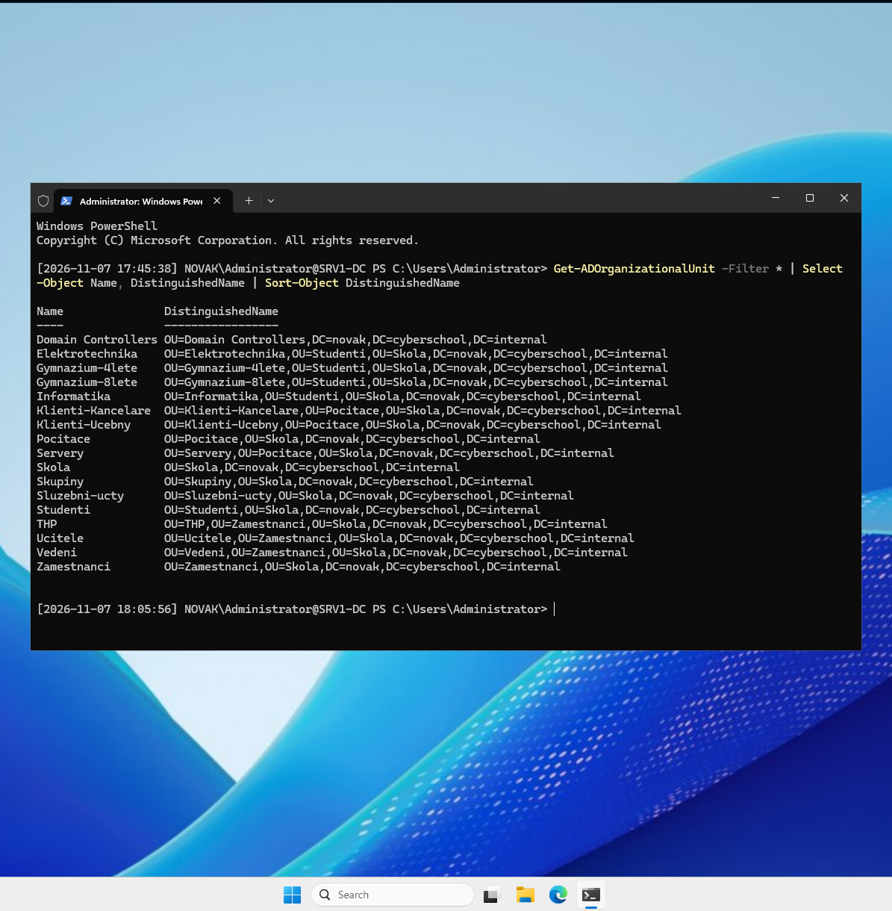

### 2. Skupiny existují se správným rozsahem a typem (SRV1-DC)

```powershell
$baseDN = (Get-ADDomain).DistinguishedName
Get-ADGroup -Filter * -SearchBase "OU=Skupiny,OU=Skola,$baseDN" | Select-Object Name, GroupScope, GroupCategory | Sort-Object Name
```

Vrátí všech **14 skupin** (`GG_Studenti`, `GG_Studenti_G8`, `GG_Studenti_G4`, `GG_Studenti_EL`, `GG_Studenti_IT`, `GG_Ucitele`, `GG_Zamestnanci`, `GG_Vedeni`, `GG_THP`, `GG_Sekretariat`, `GG_PK_Matematika`, `GG_PK_Informatika`, `GG_PK_Jazyky`, `GG_IT-Sprava`), všechny `GroupScope = Global` a `GroupCategory = Security`.

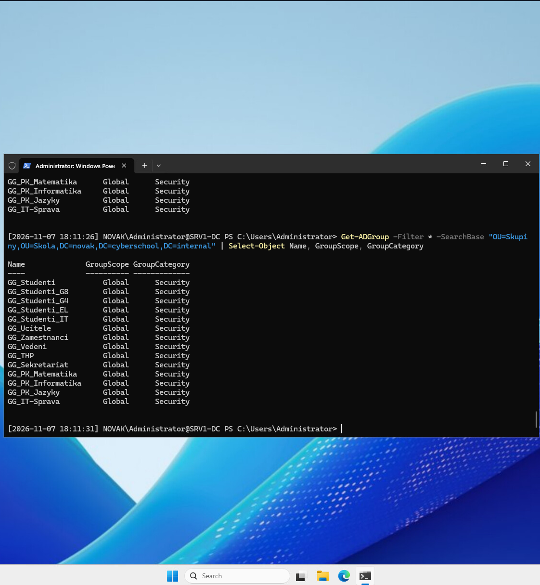

### 3. Členství ve skupinách odpovídá zadání (SRV1-DC)

```powershell
Get-ADGroupMember GG_Ucitele | Select-Object Name
Get-ADGroupMember GG_PK_Informatika | Select-Object Name
Get-ADGroupMember GG_Zamestnanci | Select-Object Name
Get-ADGroupMember GG_Studenti | Select-Object Name
Get-ADGroupMember GG_Studenti -Recursive | Select-Object Name
```

- `GG_Ucitele` obsahuje `jana.teacher` a `petr.teacher`.
- `GG_PK_Informatika` obsahuje `jana.teacher`, `GG_PK_Matematika` obsahuje `petr.teacher`.
- `GG_Zamestnanci` obsahuje vnořené skupiny `GG_Ucitele`, `GG_THP`, `GG_Vedeni` (rekurzivně i `marie.zamestnanec` a `karel.zamestnanec`).
- `GG_Studenti` obsahuje přímo pouze čtyři oborové skupiny `GG_Studenti_G8`, `GG_Studenti_G4`, `GG_Studenti_EL`, `GG_Studenti_IT` (`objectClass = group`); výpis s `-Recursive` vrátí všech 6 žáků.
- `GG_Studenti_G8` (`lucie.student`, `ondrej.student`), `GG_Studenti_G4` (`adam.student`, `klara.student`), `GG_Studenti_EL` (`tomas.student`), `GG_Studenti_IT` (`eva.student`).
- `GG_Vedeni` (`karel.zamestnanec`), `GG_Sekretariat` (`marie.zamestnanec`).

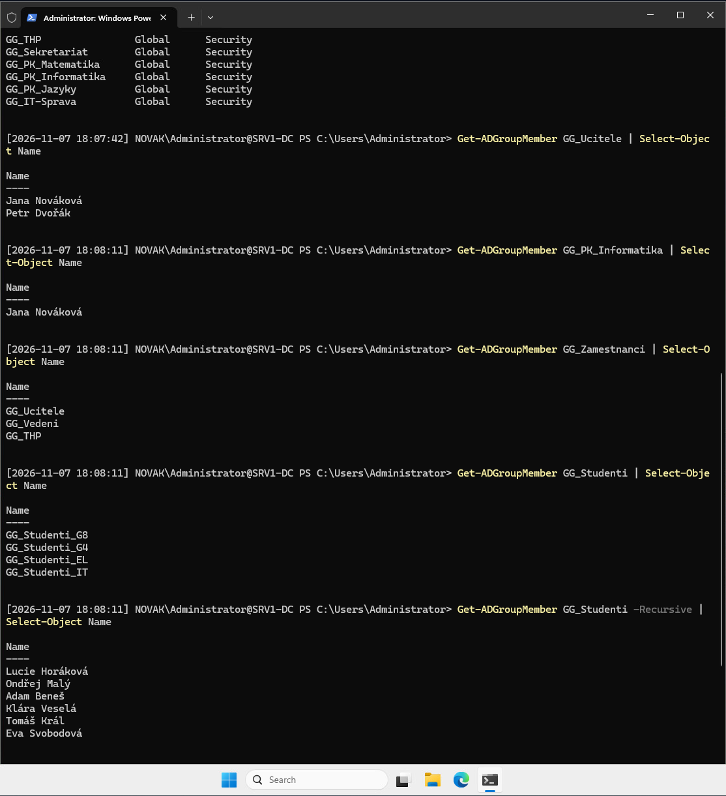

### 4. Účty existují ve správných OU a jsou aktivní (SRV1-DC)

```powershell
$baseDN = (Get-ADDomain).DistinguishedName
Get-ADUser -Filter * -SearchBase "OU=Skola,$baseDN" -Properties Enabled | Select-Object Name, Enabled, DistinguishedName | Sort-Object Name
```

Vrátí **10 účtů** (`jana.teacher`, `petr.teacher`, `karel.zamestnanec`, `marie.zamestnanec`, `lucie.student`, `ondrej.student`, `adam.student`, `klara.student`, `tomas.student`, `eva.student`), všechny ve správné OU a `Enabled = True`.

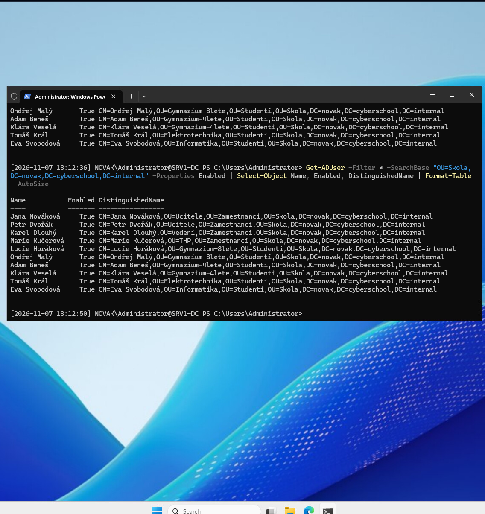

### 5. Přihlášení na klientovi funguje pro každou postavu (PC1-WIN)

Na stanici **PC1-WIN** projde přihlášení se stejným heslem `Pa55w.rd` postupně pro účty `eva.student@<prijmeni>.cyberschool.internal`, `lucie.student@<prijmeni>.cyberschool.internal`, `jana.teacher@<prijmeni>.cyberschool.internal` a `karel.zamestnanec@<prijmeni>.cyberschool.internal`.

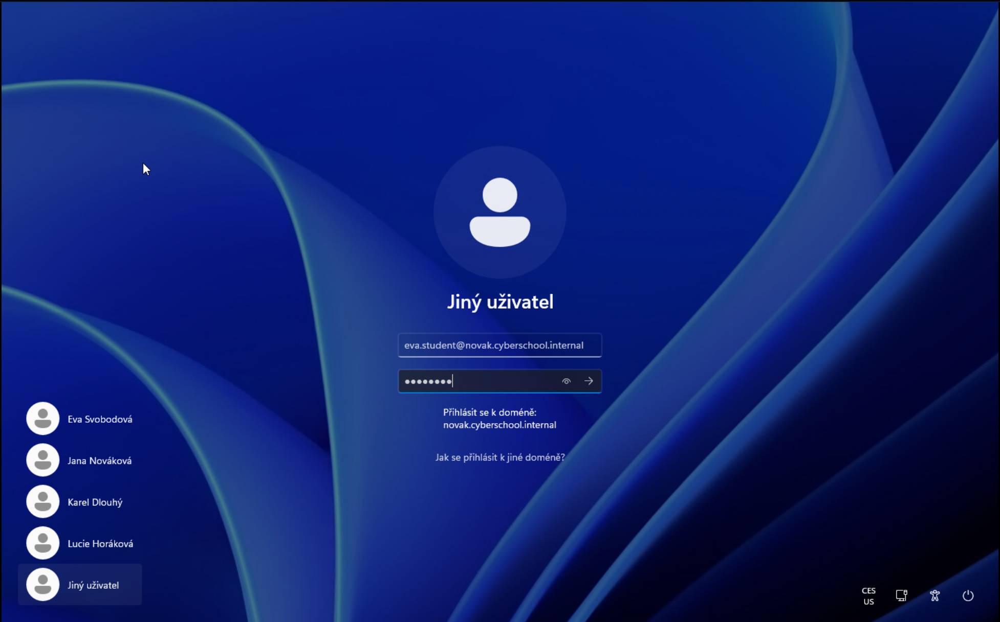

### 6. Domovské složky fungují (SRV1-DC a PC1-WIN)

Po přihlášení na `PC1-WIN` má `eva.student` připojený síťový disk `H:` (`\\SRV1-DC\home$\eva.student`) a může do něj zapisovat. Jiný uživatel (`tomas.student`) dostane při pokusu otevřít `\\SRV1-DC\home$\eva.student` chybu **Access is denied**.

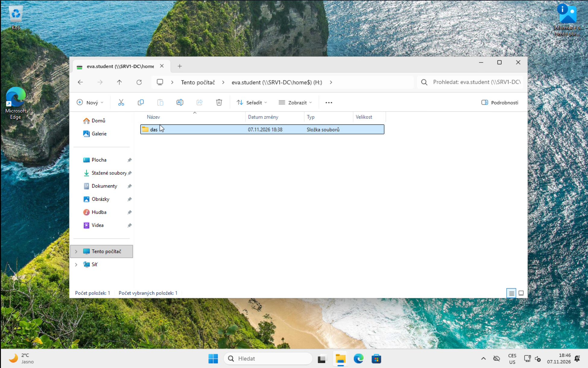

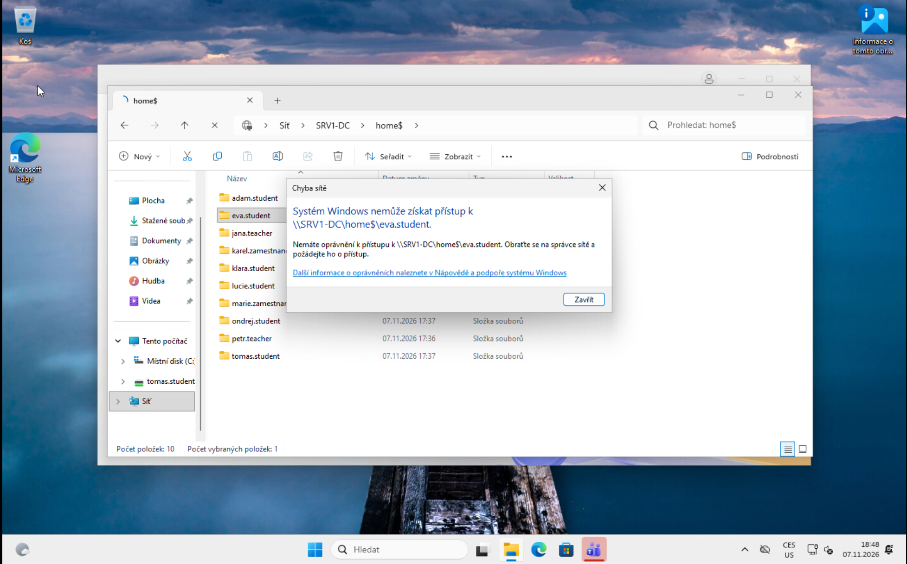

### 7. Klient je viditelný ve správné OU (SRV1-DC)

Počítačový objekt `PC1-WIN` leží v `OU=Klienti-Ucebny,OU=Pocitace,OU=Skola,...`:

```powershell
Get-ADComputer -Identity "PC1-WIN" | Select-Object Name, DistinguishedName
```

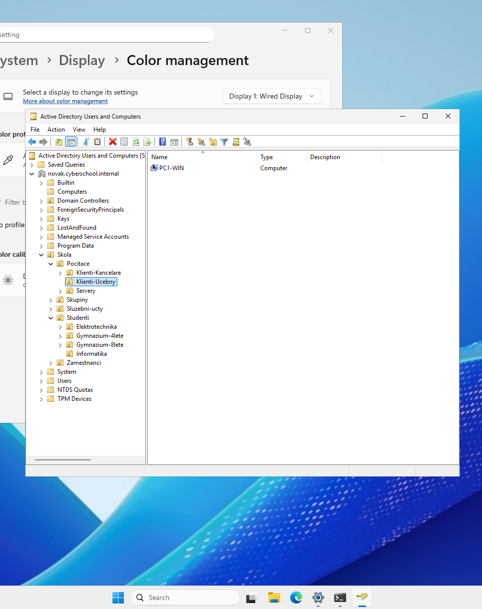

### 8. Žádný personalizovaný admin účet neexistuje (SRV1-DC)

```powershell
Get-ADUser -Filter "SamAccountName -like '*juchelka*' -or SamAccountName -like '*peclivy*'"
```

Vrátí **prázdný výsledek** — správa probíhá výhradně přes vestavěný účet `Administrator`.

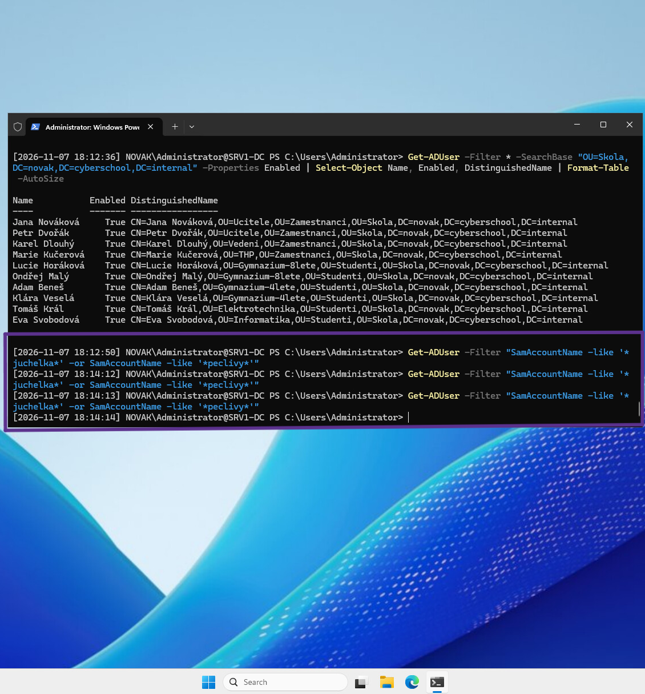

### 9. Kočovné profily jsou nastavené a funkční (SRV1-DC a PC1-WIN)

Na **SRV1-DC** existuje sdílení `profiles$` (`C:\profiles`), všichni uživatelé mají `ProfilePath = \\SRV1-DC\profiles$\<ucet>`, a po přihlášení a **odhlášení** uživatelky `eva.student` na `PC1-WIN` vznikne na serveru složka `C:\profiles\eva.student.V6`:

```powershell
Get-SmbShare -Name 'profiles$' | Select-Object Name, Path
Get-ADUser eva.student -Properties ProfilePath | Select-Object SamAccountName, ProfilePath
Get-ChildItem C:\profiles | Select-Object Name
```

Na **PC1-WIN** profil potvrdí také příkaz:

```powershell
net user eva.student /domain
```

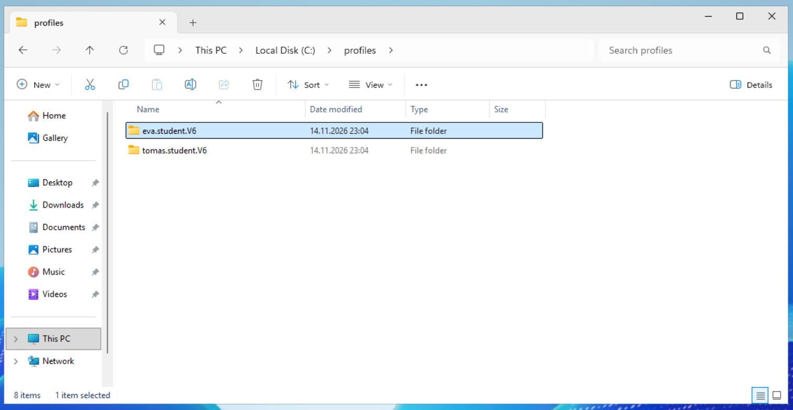

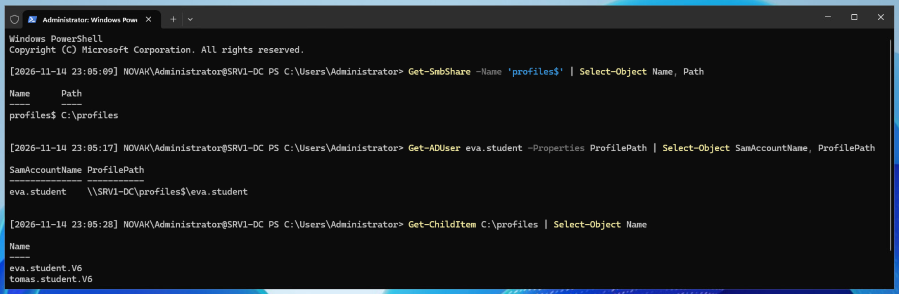

### 10. Otisk konfigurace pro odevzdání (SRV1-DC a PC1-WIN)

**Na SRV1-DC:**
```powershell
Get-Date
whoami
hostname
(Get-CimInstance Win32_ComputerSystemProduct).UUID
(Get-ADDomain).DNSRoot
(Get-ADDomain).DomainSID.Value
```

**Na PC1-WIN:**
```powershell
Get-Date
whoami
hostname
(Get-CimInstance Win32_ComputerSystemProduct).UUID
(Get-CimInstance Win32_ComputerSystem).Domain
```

### 11. (Nepovinné) Rychlé automatické ověření celého stroje

**Na serveru SRV1-DC:**
```powershell
powershell -ExecutionPolicy Bypass -Command "curl.exe --progress-bar -L https://raw.githubusercontent.com/DeepyCat/well_ops/main/skripty/04_check_SRV1-DC.bat -o check.bat; .\check.bat; Remove-Item -Force check.bat -ErrorAction SilentlyContinue"
```

**Na klientovi PC1-WIN:**
```powershell
powershell -ExecutionPolicy Bypass -Command "curl.exe --progress-bar -L https://raw.githubusercontent.com/DeepyCat/well_ops/main/skripty/04_check_PC1-WIN.bat -o check.bat; .\check.bat; Remove-Item -Force check.bat -ErrorAction SilentlyContinue"
```
