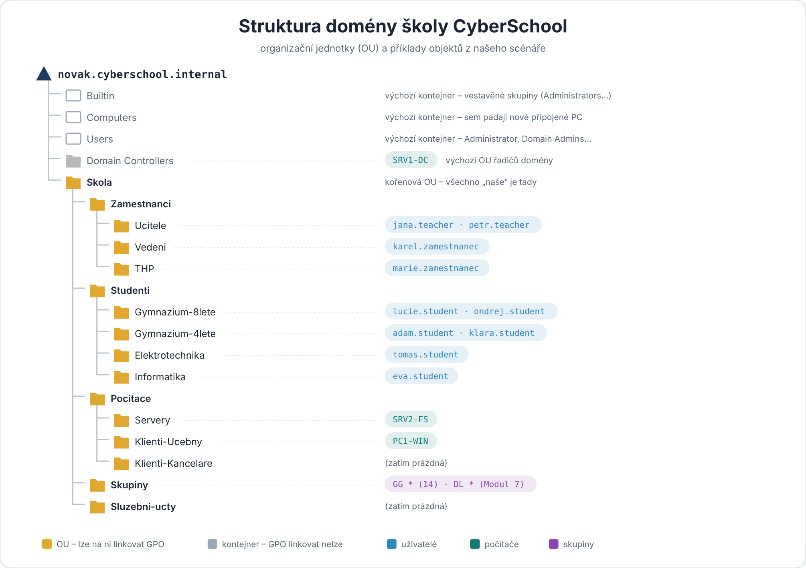

# [Co má být na konci modulu a jak to vypadá?]

> **Přibližný potřebný čas:** 6 vyučovacích hodin &nbsp;|&nbsp; **Verze:** 2026-11-15

> [!WARNING] Modul ve vývoji
> Materiály se v průběhu školního roku upravují, změny najdete v `CHANGELOG.md`. Hodnotí se podle verze platné v den termínu odevzdání modulu; pracujete-li dopředu, úpravy po pozdější změně jsou na vás.

## Kontext (proč to děláme)

Máme doménu, DHCP i DNS, ale zatím jen jediný účet `Administrator` a počítače jsou mimo doménu. V tomhle modulu postavíme skutečnou adresářovou strukturu pro školu **CyberSchool** (organizační jednotky, bezpečnostní skupiny podle modelu AGDLP, reálné účty učitelů, vedení, THP a šesti žáků všech čtyř oborů, provizorní domovské složky a kočovné profily) a připojíme do domény první klientskou stanici **PC1-WIN**.

> **Pravidlo pro pracoviště:** Ve vzorovém postupu je číslo pracoviště `200` a příjmení `novak`. Vy všude dosaďte číslo svého pracoviště (`192.168.N.x`, kde `N` je číslo pracoviště) a své příjmení bez diakritiky (`prijmeni.cyberschool.internal`).

## Předpoklad: hotový Modul 00, Modul 01, Modul 02 a Modul 03

Server **SRV1-DC** je řadičem domény lesa `<prijmeni>.cyberschool.internal` se statickou IP adresou `192.168.N.10/24` na rozhraní `Ethernet1`, funkčním DNS Serverem (dopředná i reverzní zóna) a DHCP Serverem. Klientská stanice **PC1-WIN** má Windows 11 a používá `192.168.N.10` jako primární DNS server na `Ethernet1`.

## Cílový stav: Struktura Active Directory, skupiny, účty a klient



### Struktura OU

V Active Directory pod kořenem `<prijmeni>.cyberschool.internal` existuje následující hierarchie organizačních jednotek (**všechny s ochranou proti smazání** `ProtectedFromAccidentalDeletion = True`):

```text
<prijmeni>.cyberschool.internal
└── Skola
    ├── Zamestnanci
    │   ├── Ucitele
    │   ├── Vedeni
    │   └── THP
    ├── Studenti
    │   ├── Gymnazium-8lete
    │   ├── Gymnazium-4lete
    │   ├── Elektrotechnika
    │   └── Informatika
    ├── Pocitace
    │   ├── Servery
    │   ├── Klienti-Ucebny
    │   └── Klienti-Kancelare
    ├── Skupiny
    └── Sluzebni-ucty
```

Celkem tedy existuje **16 OU pod Skola** (včetně kořenové `Skola`) + výchozí OU `Domain Controllers` = **17 OU**. Žáky třídíme **podle oborů**, nikoli podle ročníků.

### Bezpečnostní skupiny (14 skupin v `Skola\Skupiny`, všechny Global Security)

Používáme **globální bezpečnostní skupiny (`GG_`)** pro sdružování uživatelů podle role (model **AGDLP**; doménové lokální skupiny `DL_...` vzniknou v Modulu 06/07 při nasazení SRV2-FS):

| Skupina | Rozsah / Typ | Kdo je členem | Účel |
|---|---|---|---|
| `GG_Studenti` | Global / Security | Vnořené `GG_Studenti_G8`, `_G4`, `_EL`, `_IT` | Souhrnná skupina „všichni žáci“ |
| `GG_Studenti_G8` | Global / Security | Žáci osmiletého gymnázia (`lucie.student`, `ondrej.student`) | Pravidla a práva pro obor G8 |
| `GG_Studenti_G4` | Global / Security | Žáci čtyřletého gymnázia (`adam.student`, `klara.student`) | Pravidla a práva pro obor G4 |
| `GG_Studenti_EL` | Global / Security | Žáci oboru Elektrotechnika (`tomas.student`) | Pravidla a práva pro obor EL |
| `GG_Studenti_IT` | Global / Security | Žáci oboru Informatika (`eva.student`) | Pravidla a práva pro obor IT |
| `GG_Ucitele` | Global / Security | Pedagogové (`jana.teacher`, `petr.teacher`) | Společná práva učitelů |
| `GG_Zamestnanci` | Global / Security | Vnořené `GG_Ucitele`, `GG_THP`, `GG_Vedeni` | Všichni zaměstnanci školy |
| `GG_Vedeni` | Global / Security | Ředitel (`karel.zamestnanec`) | Složka `Vedeni` a jiná GPO |
| `GG_THP` | Global / Security | Administrativa (`marie.zamestnanec`) | Složka `THP` / `Smernice` |
| `GG_Sekretariat` | Global / Security | Podmnožina THP v sekretariátu (`marie.zamestnanec`) | Cílené filtrování GPO (Modul 05) |
| `GG_PK_Matematika` | Global / Security | `petr.teacher` | Komise matematiky |
| `GG_PK_Informatika` | Global / Security | `jana.teacher` | Komise informatiky |
| `GG_PK_Jazyky` | Global / Security | Rezerva pro učitele jazyků | Komise jazyků |
| `GG_IT-Sprava` | Global / Security | Rezerva pro delegování IT správy | Správa infrastruktury |

### Uživatelské účty (10 účtů, heslo `Pa55w.rd`, bez vynucené změny hesla)

| Účet (`SamAccountName`) | Jméno | OU | Přímé členství ve skupinách |
|---|---|---|---|
| `jana.teacher` | Jana Nováková | `Skola\Zamestnanci\Ucitele` | `GG_Ucitele`, `GG_PK_Informatika` |
| `petr.teacher` | Petr Dvořák | `Skola\Zamestnanci\Ucitele` | `GG_Ucitele`, `GG_PK_Matematika` |
| `karel.zamestnanec` | Karel Dlouhý | `Skola\Zamestnanci\Vedeni` | `GG_Vedeni` |
| `marie.zamestnanec` | Marie Kučerová | `Skola\Zamestnanci\THP` | `GG_THP`, `GG_Sekretariat` |
| `lucie.student` | Lucie Horáková | `Skola\Studenti\Gymnazium-8lete` | `GG_Studenti_G8` |
| `ondrej.student` | Ondřej Malý | `Skola\Studenti\Gymnazium-8lete` | `GG_Studenti_G8` |
| `adam.student` | Adam Beneš | `Skola\Studenti\Gymnazium-4lete` | `GG_Studenti_G4` |
| `klara.student` | Klára Veselá | `Skola\Studenti\Gymnazium-4lete` | `GG_Studenti_G4` |
| `tomas.student` | Tomáš Král | `Skola\Studenti\Elektrotechnika` | `GG_Studenti_EL` |
| `eva.student` | Eva Svobodová | `Skola\Studenti\Informatika` | `GG_Studenti_IT` |

- Všichni uživatelé mají UPN `<ucet>@<prijmeni>.cyberschool.internal`, `Enabled = True`, heslo `Pa55w.rd` a odškrtnutou volbu `ChangePasswordAtLogon`.
- Administrace probíhá výhradně pod vestavěným účtem **`Administrator`** — **žádný** účet `*juchelka*` ani `*peclivy*` nesmí existovat.

### Domovské složky a kočovné profily (provizorně na SRV1-DC)

- **`C:\home`** sdílená jako skryté sdílení **`home$`**: každý z 10 uživatelů má na účtu nastaveno `HomeDrive = H:` a `HomeDirectory = \\SRV1-DC\home$\%username%` a vlastní izolovanou podsložku (nikdo cizí se do složky jiného uživatele nedostane).
- **`C:\profiles`** sdílená jako skryté sdílení **`profiles$`**: každý z 10 uživatelů má `ProfilePath = \\SRV1-DC\profiles$\%username%`. Podsložky profilů (např. `eva.student.V6`) **nevytvářejte ručně** — vytvoří je Windows při prvním odhlášení uživatele z `PC1-WIN`.

### Klientská stanice PC1-WIN v doméně

- Počítač **PC1-WIN** je připojený do domény `<prijmeni>.cyberschool.internal` a jeho počítačový objekt je přesunut z `CN=Computers` do **`Skola\Pocitace\Klienti-Ucebny`**.

## Rychlé automatické ověření strojů (nepovinné)

Pro oba stroje jsou k dispozici interaktivní read-only auditovací skripty (spouští se v PowerShellu, CMD i Terminálu):

**Na serveru SRV1-DC:**
```powershell
powershell -ExecutionPolicy Bypass -Command "curl.exe --progress-bar -L https://raw.githubusercontent.com/DeepyCat/well_ops/main/skripty/04_check_SRV1-DC.bat -o check.bat; .\check.bat; Remove-Item -Force check.bat -ErrorAction SilentlyContinue"
```

**Na klientovi PC1-WIN:**
```powershell
powershell -ExecutionPolicy Bypass -Command "curl.exe --progress-bar -L https://raw.githubusercontent.com/DeepyCat/well_ops/main/skripty/04_check_PC1-WIN.bat -o check.bat; .\check.bat; Remove-Item -Force check.bat -ErrorAction SilentlyContinue"
```

## Co odevzdat

Po dokončení modulu se odevzdává jeden ZIP archiv s přesným názvem `Prijmeni_Jmeno_Modul4.zip` obsahující složku:

- `Moje dokumentace / Modul 4 Active Directory` (`postup.md`, `overeni.md` a složka `images` se screenshoty)
